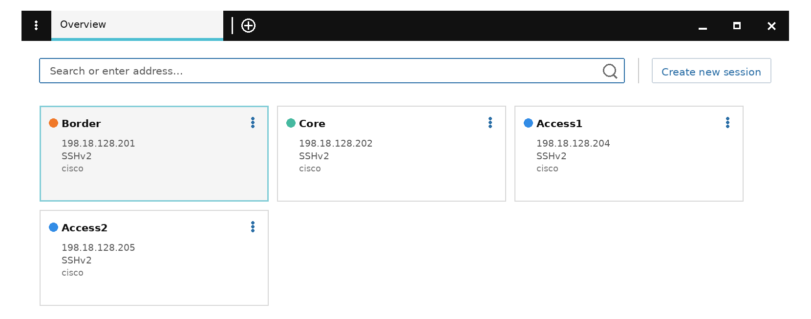

# Step 1 - SSH to the Lab Devices

Before diving into Network as Code automation, it's important to establish
baseline connectivity to your IOS-XE devices and understand their current
state. In this task, you'll use Solar-PuTTY to connect to the lab devices
and verify their configuration.

## What You'll Learn

- How to connect to IOS-XE devices using Solar-PuTTY
- How to verify device information with basic `show` commands
- What minimal configuration is required for Network as Code/RESTCONF
  automation

## RESTCONF and NETCONF

IOSXE-as-Code can use either RESTCONF or NETCONF to communicate with network
devices. This version of the lab guide focuses on RESTCONF - see the
[Cheat Sheet](CheatSheet.md) for the shared device credentials used
throughout this section.

## Open Solar-PuTTY

Solar-PuTTY is an enhanced SSH client that provides a tabbed interface for
managing multiple device connections. It's pre-installed on the lab Windows
jump machine and ready to use.

To launch Solar-PuTTY:

1. Look for the **Solar-PuTTY** icon on the Windows desktop.
2. Double-click to open the application.
3. You'll see the Solar-PuTTY interface with a list of devices.

<figure markdown="span">
  { width="85%" }<figcaption>Solar-PuTTY,
  pre-configured with SSH connections to every lab device.</figcaption>
</figure>

## Connect to the Lab Devices

The lab environment includes four IOS-XE switches. All device credentials
are pre-configured in Solar-PuTTY, so you can connect immediately without
entering any login information.

Devices in this lab:

| Device | Role | IP Address |
|---|---|---|
| Border | Border switch | 198.18.128.201 |
| Core | Core switch | 198.18.128.202 |
| Access1 | Access switch | 198.18.128.204 |
| Access2 | Access switch | 198.18.128.205 |

!!! tip "Additional devices"
    The lab topology also includes `Host1` and `Host2` - two unmanaged
    Alpine Linux hosts attached to `Access1`/`Access2`, used for end-to-end
    connectivity testing. They won't be managed via Network as Code in this
    lab.

!!! note "Lab topologies reference"
    At any time during the lab, refer to [Topologies](Topologies.md) for the
    full topology diagram, device IP addresses, and credentials.

To connect to a device:

1. In Solar-PuTTY, double-click on a device (e.g. `Core`).
2. You'll be automatically logged in with the pre-configured credentials.

## Verify Device Information

Once connected to the switch, run the following command to verify the
device information:

```text
show version
```

This displays:

- IOS XE software version
- Device model
- Uptime and system information
- Hardware details

Take a moment to review the output - you'll see this is a virtual Catalyst
9000 switch running IOS XE.

## Review Current Configuration

Now check the running configuration to see what's currently configured on
the device:

```text
show run
```

!!! note "Minimal by design"
    The lab device configurations are almost empty - this is intentional!
    The switches have minimal configurations, which provides a clean slate
    for you to deploy Network as Code configurations via Terraform. You will
    see a few essential lines that enable Terraform to access the devices.

Once you've reviewed `show version`/`show run` on `Core`, do the same on
`Access1`, `Access2`, and `Border`.

## Configuration Required for Terraform Access

Look for these specific configuration lines in the `show run` output:

```text
username nac_admin privilege 15 secret cisco
...
ip http secure-server
...
restconf
```

What these commands do:

- **`ip http secure-server`** - enables the HTTPS server on the switch,
  required for RESTCONF API access.
- **`restconf`** - enables the RESTCONF API, which Terraform uses to
  configure the device.
- **`username nac_admin privilege 15 secret cisco`** - creates the
  administrative user Terraform uses for authentication (shown encrypted in
  `show run` for security).

!!! tip "Dedicated automation user"
    It's good practice to have a dedicated administrative user configured
    for automation tasks, as shown above with `nac_admin`. This separates
    human and automated access for better security and auditing. With the
    Network as Code framework, this user needs to be configured on every
    device Terraform will manage.

## Enabling RESTCONF Manually

!!! note
    You don't need to do this now - it's already configured on all lab
    devices. This is for reference if you ever enable RESTCONF on a new
    device.

```text
config t
ip http secure-server
restconf
username nac_admin privilege 15 secret cisco
end
write memory
```

Very recently, NETCONF support has also been added to the
[`ciscodevnet/iosxe` Terraform provider](https://registry.terraform.io/providers/CiscoDevNet/iosxe/latest)
as the default protocol. Future versions of this lab may include NETCONF
examples as well.

!!! warning "RESTCONF takes a few minutes to come up"
    If you try this on your own devices after the event, note that after
    enabling RESTCONF, it takes a few minutes for the RESTCONF API to become
    available. You can verify availability from a client machine with:

    ```sh
    curl -i -k -X "GET" "https://<IP_ADDRESS>/restconf/" -u <USERNAME>:<PASSWORD>
    ```

---

**← Previous:** [Applying Part 1](Meraki06_applying.md) · **Next:** [Global config](IOSXE01_global.md)
