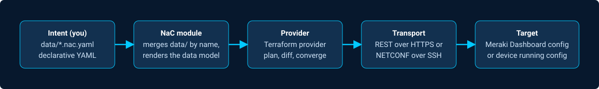

# Autocon 2026 - Network-as-Code Lab Guide

## Learning objectives

This step-by-step guide walks you through the Autocon 2026 Network-as-Code
lab, covering **both** Meraki and IOS-XE. By the end, you will know how to
deploy and manage Meraki and IOS-XE infrastructure with declarative
Network-as-Code YAML and CI/CD pipelines.

!!! tip "New to these acronyms?"
    See the [Glossary](Glossary.md) in the top navigation. Keep it open in a
    separate tab.

The guide walks through both halves of the lab, in order:

- **Part 1 - Meraki**, starting with logging into your lab Dashboard
  organization, then five steps authoring a single-branch Meraki network
  (one per shared pod, appliance/switch/wireless) directly in YAML, ending
  on a templating/indirection capstone.
- **Part 2 - IOS-XE**, a small four-device lab (`Border`, `Core`, `Access1`,
  `Access2`) where you register each device's identity, then layer on shared
  configuration through device groups and global settings, finishing with
  the same templating/indirection pattern from Part 1 so the two halves
  reinforce each other.

The two parts are deliberately paired: Meraki is a controller-managed
platform (you configure a cloud Dashboard, which then pushes to devices),
while IOS XE is configured directly, device by device, over NETCONF. Walking
through both shows that Network as Code isn't tied to one architecture - the
same YAML-in, Terraform-module, provider-out workflow automates a
cloud controller and a direct-to-device platform equally well.

## What is Network as Code?

Network as Code (NaC) is a methodology that applies DevOps principles to
network management through declarative data models. Rather than writing
scripts or clicking through GUIs, network engineers describe their intended
network state in human-readable YAML files. The Network as Code toolchain -
built on Terraform - handles the how: translating intent into
platform-specific configuration, tracking state, and pushing only what
changed.

Network as Code is an umbrella that spans multiple Cisco platforms and
architectures. Each platform has its own Terraform module and provider, but
they all share the same methodology: YAML intent files -> Terraform module ->
platform provider -> device/dashboard.

The supported platforms include ACI (APIC), Nexus Dashboard Orchestrator
(NDO), Nexus Dashboard VXLAN EVPN, NX-OS, Catalyst Center, Catalyst SD-WAN,
Meraki, ISE, Secure Firewall (FMC), IOS XR, and - the two platforms this lab
covers - **Meraki** and **IOS XE**.

- **Meraki as Code** uses the `netascode/terraform-meraki-nac-meraki` module
  and the `CiscoDevNet/meraki` provider to push configuration to the Meraki
  Dashboard's cloud-hosted REST API.
- **IOS XE as Code** uses the `netascode/terraform-iosxe-nac-iosxe` module and
  the `CiscoDevNet/iosxe` provider to push YANG-modeled configuration to
  on-box devices (Catalyst 9000, C8000V, ISR, ASR, etc.) over NETCONF.

The same workflow applies to every Network as Code platform; only the data
model and transport differ.

## Why this lab matters

Traditional network management relies on manual CLI commands, scripts, and
brittle templates. The typical failure modes - configuration drift, human
error, no change history, and no safe way to preview or test changes - are
well known.

This lab shows how Network as Code addresses each of them using:

- **Declarative configuration** - define the desired state, not the steps
  to reach it
- **Terraform** - industry-standard Infrastructure-as-Code engine
- **Schema validation** - catch misconfigurations before they ever reach a
  device or the Dashboard
- **Post-deployment testing** - verify what was deployed actually matches
  what you asked for
- **CI/CD pipelines** - automate validation, deployment, and testing
  end-to-end

### Terminology

"Meraki as Code", "IOS XE as Code" / "IOSXE-as-Code", and "Network as Code"
all refer to the same methodology in this guide - just applied to a
different platform. Both parts of this lab use the same underlying mechanic:
a Terraform `nac-*` module reads every YAML file under a project's `data/`
directory, deep-merges them into one model (matching on `name` at each
nesting level), and applies the result. File names and numeric prefixes are
a **reading order**, not a deployment order - Terraform builds its own
dependency graph from the merged model.

## What the Network as Code stack looks like

Network as Code isn't a single tool, it's a layered stack. You write intent
in YAML, and the stack turns it into platform-specific configuration. The
layers are the same shape for both tracks in this lab - only layers 3-5
differ by platform:

<figure markdown="span">
  
</figure>

| Layer | What it is | Meraki track | IOS XE track |
|---|---|---|---|
| 1. Intent (what you write) | `*.nac.yaml` - declarative YAML, human-readable, under version control | same | same |
| 2. NaC Terraform module | Merges every YAML in `data/`, resolves variables/templates, renders the data model | `netascode/terraform-meraki-nac-meraki` | `netascode/terraform-iosxe-nac-iosxe` |
| 3. Terraform provider | Turns the merged model into resource-level API calls; knows how to diff and converge | `CiscoDevNet/meraki` | `CiscoDevNet/iosxe` |
| 4. Transport | How the provider talks to the platform | HTTPS / REST to the Meraki Dashboard API | NETCONF over SSH (TCP 830), with a candidate datastore for transactional commits |
| 5. Target | Where configuration ends up | Meraki Dashboard-managed cloud configuration | Device's YANG-modeled running configuration |

You are responsible for layer 1; NaC owns layers 2 through 4. The value of
NaC isn't found in any single layer - it's that you no longer have to write
layers 2, 3, and 4 yourself. You describe intent, and the module handles
module composition, Terraform resource wiring, and platform-specific
API/YANG path construction.

!!! note "New to YANG?"
    YANG is the data modeling language IOS XE uses to describe its
    configuration. You don't need to read or write YANG in this lab (the
    provider handles it), but it's why versions matter for the IOS XE track
    specifically - Meraki's Dashboard API has no equivalent per-version
    schema drift.

## What you'll learn

By completing this lab, you will gain hands-on experience with:

- Writing declarative Meraki and IOS XE configurations in Network as Code
  YAML format
- Deploying configurations using the Network as Code Terraform modules
- Understanding the Network as Code configuration hierarchy (org/network and
  global -> group -> device, depending on platform)
- Using variables and templates for reusable, scalable configurations
- Pre-deployment validation with `nac-validate` (schema and semantic checks)
- Post-deployment validation with `nac-test` (automated Robot Framework
  tests)
- Automating the full Infrastructure-as-Code lifecycle with CI/CD
  pipelines
- Implementing GitOps workflow safeguards (branch protection, merge
  requests)

---

**Next:** [Environment Setup](Intro02_environment.md){.next-only}
