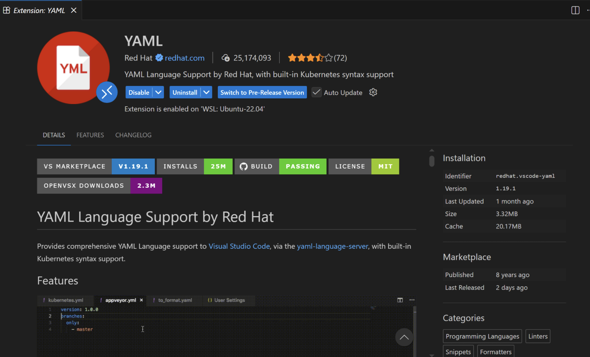
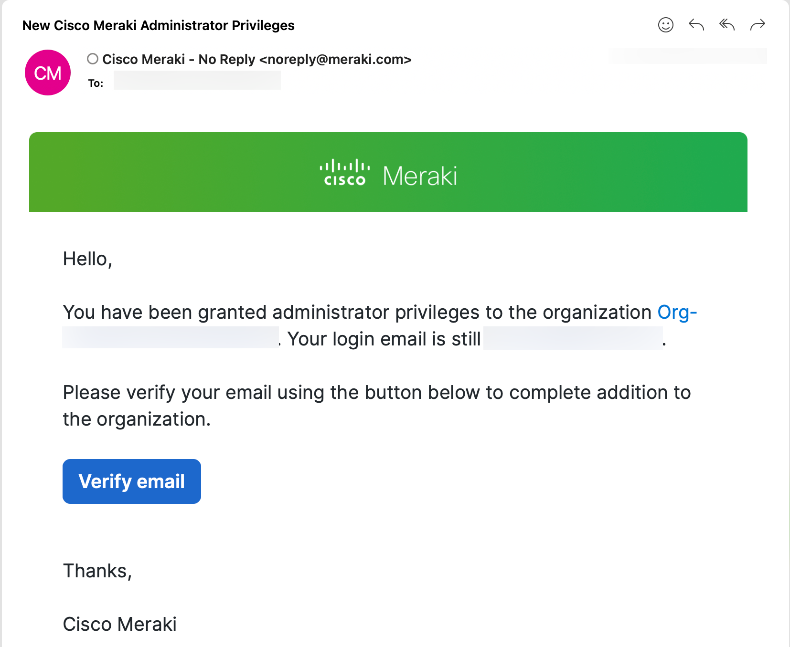
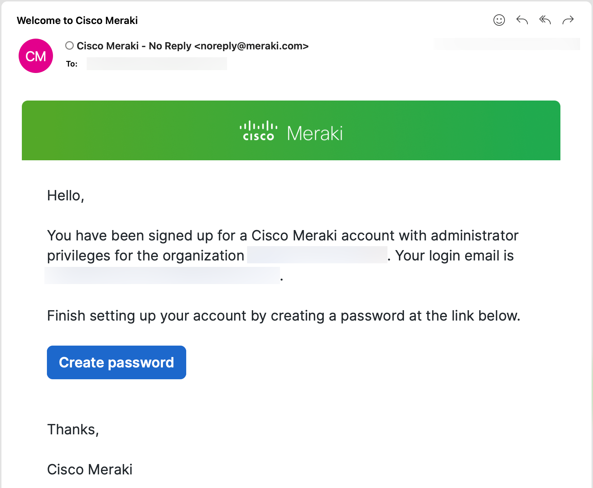

# Environment Setup

This lab has four moving pieces. Get oriented on all four before diving into
either track:

1. **Windows Jump Machine** - the shared lab desktop with VS Code, WSL, and
   Terraform pre-installed, reachable over WebRDP without a VPN.
2. **CI/CD** - after running through the steps manually, we will be pushing the configuration to the devices through CICD as well. As part of the lab enviroment we installed GitLab CI, but we will provide you also with eqivaalent Github actions you can run at your own repository.  GitLab project is reachable from the jump machine's
   browser, or directly if you're on VPN to run the pipeline.
3. **Meraki Dashboard** - the cloud controller for Part 1, accessed with
   your own account under a Bring Your Own Account (BYOA) model.
4. **IOS-XE Virtual Lab** - the four virtualized switches for Part 2,
   reached over SSH either via the jump machine or directly over VPN.

See the [Cheat Sheet](CheatSheet.md) at any point for the exact URLs and
credentials for each of these.

## 1. Windows Jump Machine

This lab runs on a shared Windows jump machine with VS Code, WSL, Terraform,
and Solar-PuTTY already installed - connect to it through WebRDP.

!!! note "WebRDP connection steps coming soon"
    Instructions for connecting to your jump machine over WebRDP will be
    added here shortly.

!!! tip "Working from your own computer instead"
    If you'd rather use your own laptop instead of RDP-ing into the jump
    machine, that's fine - use whatever editor and terminal you're
    comfortable with. Just make sure you have, before the lab starts:

    - **Terraform** installed
    - **[uv](https://docs.astral.sh/uv/)** installed - this lab's Python
      tooling (`nac-validate`, `nac-test`) is installed and run through it
    - An active connection to the **lab VPN** - the GitLab instance and the
      virtualized IOS-XE devices (CML) only live inside the lab network, not
      on the public internet. On VPN, you'll reach GitLab directly (see
      [part 2](#2-gitlab-cicd) below) and SSH to the IOS-XE devices directly
      too (see [part 4](#4-ios-xe-virtual-lab)), instead of going through the
      jump machine for either.

The next few sections cover the tools already set up for you on the jump
machine - VS Code, its YAML linting extension, and WSL - before you clone the
lab repo in [part 2](#2-gitlab-cicd).

### VS Code

Visual Studio Code (VS Code) is a free, lightweight, yet powerful source
code editor developed by Microsoft. It runs on Windows, macOS, and Linux and
has become one of the most popular code editors among developers and IT
professionals.

Key features that make VS Code ideal for Network as Code:

- **Syntax highlighting** - colors and formats YAML files for easy
  readability
- **IntelliSense** - provides intelligent code completion and suggestions
- **Integrated terminal** - run commands directly within the editor
- **Extensions** - add functionality like YAML validators and schema
  support
- **Git integration** - built-in version control for tracking changes
- **Multi-file editing** - work with multiple configuration files
  simultaneously
- **File explorer** - easy navigation through project folders and files

### YAML linting with the Red Hat extension

Since Network as Code configurations are written in YAML, having proper
syntax validation is essential. VS Code supports YAML linting through the
[YAML extension by Red Hat](https://marketplace.visualstudio.com/items?itemName=redhat.vscode-yaml),
which helps catch syntax errors and enforce best practices as you write your
configuration files.

<figure markdown="span">
  { width="70%" }<figcaption>The Red Hat
  YAML extension, pre-installed in your lab environment.</figcaption>
</figure>

This extension provides:

- **Real-time syntax validation** - highlights errors as you type
- **Auto-completion** - suggests valid YAML structures
- **Formatting** - automatically formats your YAML files
- **Schema validation** - can validate against predefined schemas

The YAML extension is already pre-installed in your lab - you'll see syntax
highlighting and error detection automatically as you edit YAML files.

!!! note "File extension matters"
    The YAML extension only recognizes files ending with **`.nac.yaml`** as
    Network as Code YAML files. To benefit from its validation and
    auto-completion, make sure every configuration file you create ends in
    `.nac.yaml`.

### WSL

Windows Subsystem for Linux (WSL) lets you run a Linux environment directly
on Windows without a virtual machine. WSL is pre-installed in this lab, and
you'll use it to run Terraform commands - most DevOps tools, including
Terraform, are designed for Linux.

## 2. CI/CD

- **Your GitLab project** - the lab's own GitLab instance, where your CI/CD
  pipeline actually runs. You won't touch this until [CI/CD
  Pipeline](Meraki07_cicd.md), where you'll repoint your already-cloned repo
  at it and push.

Once you get to that step, you'll reach the GitLab instance itself (to
watch pipelines, open merge requests, etc.) either:

- **From the jump machine** - open a browser and go to the GitLab URL in the
  [Cheat Sheet](CheatSheet.md), and log in with the credentials listed
  there.
- **Over VPN, from your own laptop** - reach the same GitLab URL directly,
  with the same credentials, and work with whatever local editor/terminal
  you set up in [part 1](#1-windows-jump-machine).

For now, the next few steps just get the starter repo in place: clone it,
open it in VS Code, and confirm Autosave is on before you start editing.

### Clone the starter repository

From a WSL terminal, clone the public starter repo into a dedicated project
directory on your desktop: `/Desktop/network-as-code`. This is your
workspace for both tracks - it already contains a `meraki/` and an `ios-xe/`
folder, each with its own `main.tf`, `data/`, and `data-lab-task/`.

```sh
git clone <starter-repo-url> /Desktop/network-as-code
```

!!! note "Not your GitLab project yet"
    This clones the public starter repo, not your lab GitLab project -
    that's why no VPN or GitLab login is needed for this step. [CI/CD
    Pipeline](Meraki07_cicd.md) walks through repointing this same repo at
    your GitLab project before you push anything.

### Open VS Code

To begin working with your project in a development-friendly environment,
open your project folder in VS Code:

1. Double-click the **Visual Studio Code** icon on the Windows desktop.
2. Click **File → Open Folder**.
3. In the address bar, type or paste: `/Desktop/network-as-code`.
4. Click **OK**.

### Check Autosave is on

Throughout this lab you'll switch frequently between editing YAML in VS Code
and running Terraform in the WSL terminal. Autosave means every edit is
written to disk immediately, so the terminal always sees your latest changes
without you having to remember to save manually. It should already be enabled
on your lab machine - just confirm it before you start editing:

1. Click **File** in the VS Code menu bar.
2. Check that **Auto Save** already has a checkmark next to it. If not,
   click it to turn it on.

!!! tip "Verify it's on"
    With Auto Save enabled, the dot on a file's editor tab (shown for
    unsaved changes) disappears a moment after you stop typing, instead of
    staying until you press ++cmd+s++ / ++ctrl+s++.

### Project structure

Before touching Terraform or `.env`, take a quick look at what's actually
inside `/Desktop/network-as-code`:

```text
network-as-code/
├── .env.example          # template for your pod's secrets/variables
├── meraki/               # Part 1 - Meraki track
│   ├── main.tf           # the Terraform module block for this track
│   ├── data/             # what Terraform actually reads - starts nearly empty
│   ├── data-lab-task/    # staged files you move into data/ one step at a time
│   ├── rules/            # nac-validate semantic rules
│   └── tests/            # nac-test Robot Framework suite
└── ios-xe/               # Part 2 - IOS-XE track
    ├── main.tf
    ├── data/
    ├── data-lab-task/
    ├── rules/
    └── tests/
```

Both tracks share the same structure: a `main.tf` that drives the NaC module,
a `data/` folder that the module reads, a `data-lab-task/` folder containing
files you progressively move into `data/` as the lab advances, a `rules/`
folder for validation, and a `tests/` folder for post-deployment checks. You
will work within a single track's folder at a time; commands such as
`terraform plan` must always be run from within `meraki/` or `ios-xe/`,
never from the repository root.

### Terraform: the `main.tf` file

Each track's folder in the repo you just cloned already has its own
`main.tf` - you won't write one from scratch. It's worth understanding what's
in it before you start running Terraform against it. Here's `meraki/main.tf`:

```hcl title="meraki/main.tf"
module "meraki" {
  source           = "github.com/netascode/terraform-meraki-nac-meraki"
  yaml_directories = ["data"]
  write_model_file = "meraki_merged_configuration.nac.yaml"
}
```

!!! note "Formatting matters"
    Terraform (`.tf`) files use braces `{}` and proper indentation for
    structure. While Terraform is more forgiving than YAML, consistent
    formatting makes your code readable and maintainable - keep that in mind
    if you ever edit this file by hand.

Understanding the configuration:

- **`module "meraki"`** - declares a Terraform module named `meraki`. Modules
  are reusable Terraform configurations that encapsulate infrastructure
  logic.
- **`source`** - tells Terraform where to find the module. This points to
  the Network as Code for Meraki module on GitHub, published by Cisco under
  the `netascode` organization. The module handles all the complexity of
  translating YAML configurations into the Terraform HashiCorp Configuration
  Language (HCL) code needed by the Meraki Terraform provider. As written
  here, `source` has no version pinned, so Terraform tracks the latest
  commit on the module's default branch - you could instead append a
  `?ref=` to pin it:
    - `?ref=v1.4.0` to pin a specific, tested release tag.
    - `?ref=a1b2c3d4e5f6a7b8c9d0e1f2a3b4c5d6e7f8a9b0` to pin an exact commit,
      when you need more granularity than a tag provides.
- **`yaml_directories = ["data"]`** - specifies which directories contain
  your YAML configuration files. Terraform automatically discovers and
  processes every YAML file within the `data/` folder - more flexible than
  listing individual files, since you can add multiple YAML files to
  `data/` and they'll all be processed automatically.
- **`write_model_file = "meraki_merged_configuration.nac.yaml"`** - outputs
  the merged YAML data model to a file. Useful for debugging and for running
  Robot Framework tests against the combined configuration - you'll
  generate and examine this file later in the lab.

### Copy `.env.example` to `.env`

```sh
cp .env.example .env
```

Open `.env` and populate just these variables - everything else in the file
already has a working default for the lab:

| Variable | Where to get it |
|---|---|
| `MERAKI_API_KEY` | [Step 2 - Generate Your Meraki API Key](Meraki00_login.md#step-2-generate-your-meraki-api-key) |
| `org_name` | From your proctor |
| `branch_name` | Your own choice - must be unique within your shared org (e.g. your initials or pod number) |
| `branch_mx_serial` / `branch_ms_serial` / `branch_cw_serial` | From your proctor |

!!! note "`.env` stays local - never committed"
    `.env` is gitignored - only the blank `.env.example` template is tracked
    in Git. See the [Cheat Sheet](CheatSheet.md) for `source`-ing it before
    you run Terraform, and for the separate GitLab CI/CD Variables the
    pipeline reads instead.

## 3. Meraki Dashboard (BYOA)

Meraki Dashboard access in this lab follows the Bring Your Own Account
(BYOA) model: you use your own Meraki Dashboard account and your own API
key throughout Part 1 - Cisco does not store or manage your credentials.
Cisco grants your account administrator access to a shared lab
organization, but the account, email, and API key are all yours.

If the email you used for the lab reservation is associated with an existing
Dashboard account, you should have received a notification that new Cisco
Meraki administrator privileges have been granted to your account. Follow
the instructions in the email to accept the invite.

<figure markdown="span">
  { width="70%" }<figcaption>Creating
  your Dashboard password on first login.</figcaption>
</figure>

If this is your first time accessing Meraki Dashboard with this email, the
message will guide you to create a password.

<figure markdown="span">
  { width="70%" }<figcaption>Selecting
  your shared lab organization from the top-left org switcher.</figcaption>
</figure>

!!! danger "Shared organization"
    One Meraki organization is shared by **two participants**. Each of you
    will configure **exactly one** network within that shared org - make
    sure your network name (`branch_name`) is unique so it doesn't collide
    with your pod partner's.

This lab is designed for learning; the configurations shown are not intended
for production use as-is. Production deployments require additional
considerations around state storage, secret management, access control, and
approval workflows - most of which we note in context but do not implement
here.

## 4. IOS-XE Virtual Lab

Part 2 of the lab uses four virtualized IOS-XE switches (`Border`, `Core`,
`Access1`, `Access2`), hosted in Cisco Modeling Labs (CML) inside the lab
network - see [Topologies](Topologies.md) for the full diagram and IP
addresses. All four devices share one set of SSH credentials, listed in the
[Cheat Sheet](CheatSheet.md).

- **From the jump machine** - use Solar-PuTTY, pre-installed with every
  device already configured. See [Part 2 - SSH to the lab
  devices](IOSXE00_ssh.md) for the full walkthrough.
- **Over VPN, from your own laptop** - SSH to each device's IP address
  directly, using the credentials in the Cheat Sheet.

---

**← Previous:** [Overview](Intro01_overview.md) · **Next:** [Part 1 - Meraki: log in](Meraki00_login.md)
