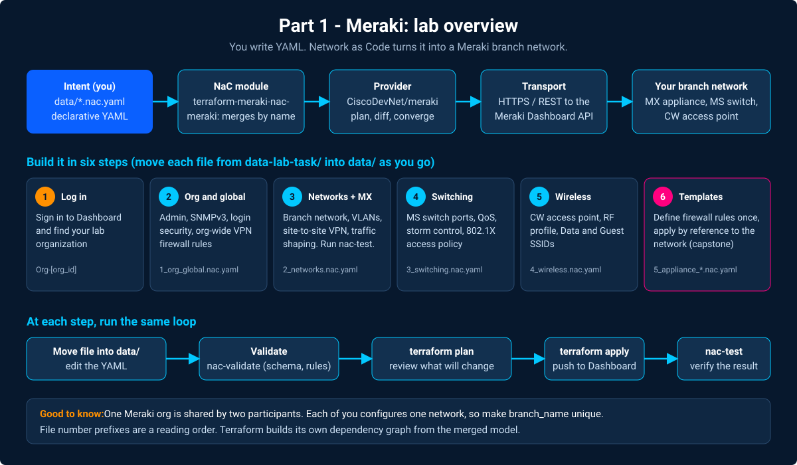

# Part 1 - Meraki

## Step 1 - Log In and Identify Your Lab Organization

Open [https://dashboard.meraki.com](https://dashboard.meraki.com) and sign in
with the email address from your lab reservation.

If your account has access to multiple organizations, click the organization
name in the top-left corner and select the lab organization - it follows the
naming pattern `Org-[org_id]`.

---

**← Previous:** [Overview](Intro01_overview.md) · **Next:** [Org and global settings](Meraki01_org_global.md)
