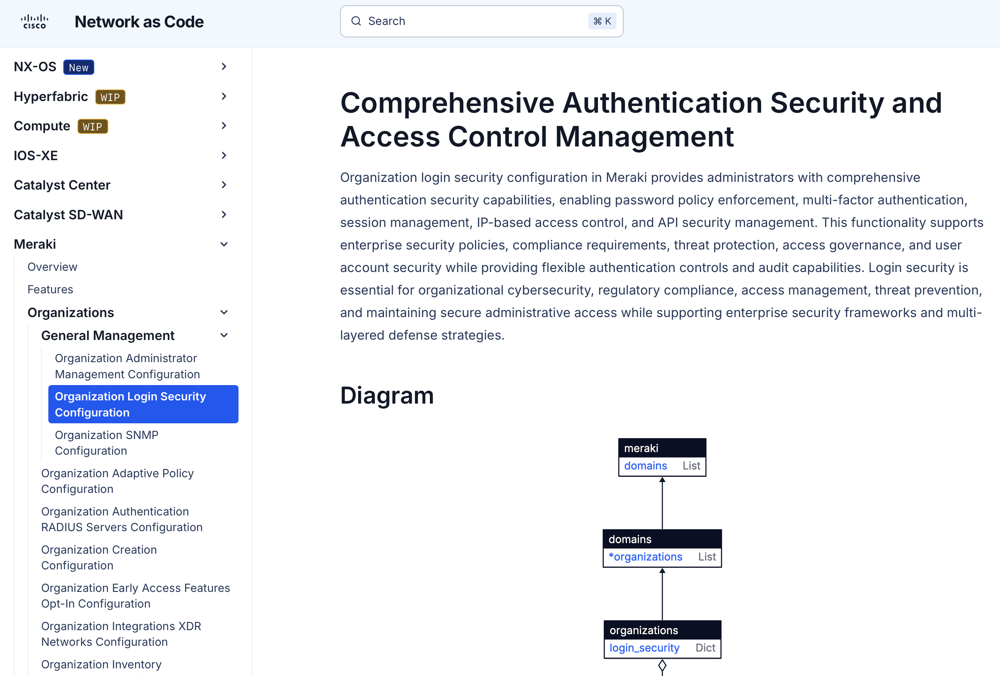

# Step 3 - `data/1_org_global.nac.yaml`: org and global settings

Each lab pod shares one Meraki organization between two participants, so two
branch networks live side by side under the same org. The organization
itself is already created for you, along with a shared Datacenter network
that every branch VPNs into - this step doesn't create any of that, it
configures organization-level settings on top of it.

An organization in Cisco Meraki is the highest-level container in the cloud
Dashboard hierarchy - it represents a single company, institution, or
department, and every network you configure belongs to one. The
organization level is where settings apply to *everything* below it,
regardless of network or device. This file sets:

- The admin user and a `login_security` policy (password expiration, lockout
  thresholds, idle timeout).
- Org-level SNMPv3 (no v2c), with the auth/priv passphrases pulled from
  environment variables via the `!env` tag rather than hardcoded in YAML.
- An org-wide `appliance.vpn_firewall_rules` rule set - shared-services and
  inter-VLAN-isolation rules every spoke inherits through the VPN hub, so you
  write them once instead of per-branch.

## Two ideas worth internalizing now

Two principles underpin everything from here on:

- **Single source of truth.** The YAML under `data/` is the one place that
  defines what your branch network should look like. Nothing is meant to be
  configured ad hoc in the Dashboard outside of it - a manual change made
  there is configuration drift waiting to be overwritten the next time
  someone runs `terraform apply`.
- **Declarative, not imperative.** You declare *what* the organization
  should look like - a login security policy, an SNMPv3 user - not *how* to
  get there. There's no sequence of clicks or API calls to write or order;
  the module and provider work that out, and Terraform's own dependency
  graph decides what happens before what, not file order. That's also why
  it doesn't matter which file in `data/` you create first: every
  `.nac.yaml` file there gets deep-merged into one model before anything is
  validated or applied.

## Open and review the file

Open `data/1_org_global.nac.yaml` and review the configuration. Near the top
you'll find the organization block with its environment-driven variables:

```yaml
organizations:
  - name: !env org_name
    managed: false
    login_security:
      enforce_password_expiration: false
      password_expiration_days: 40
      enforce_different_passwords: true
      num_different_passwords: 5
      enforce_strong_passwords: true
      enforce_account_lockout: true
      account_lockout_attempts: 5
      enforce_idle_timeout: true
      idle_timeout_minutes: 90
```

Notice that the organization's `name` uses the `org_name` variable, resolved
by the `!env` tag instead of being hardcoded. You'll set that value first in
your local `.env` file, and later in the GitLab CI/CD variables.

## Set your pod's values in `.env`

Edit the `.env` file you copied from `.env.example` earlier, and set
`org_name` to your Org ID (from your welcome email or the Meraki Dashboard):

```sh
export org_name=Org-3665367146726167151
```

You were also given the serial numbers for your pod's devices - set those
too, along with a name of your own choosing for your branch network:

```sh
export branch_name=
export branch_mx_serial=
export branch_ms_serial=
export branch_cw_serial=
```

`branch_name` can be anything unique to you - for example `"Shawn's
Network"` - just pick something specific to you (like your own name), since
two branch networks share this organization.

!!! note "`!env` vs `${...}` - two different variable mechanisms"
    `!env VAR` (used throughout this file) pulls a value from your shell
    environment - `.env` locally, CI/CD variables in the pipeline - and is
    the mechanism for anything secret or pod-specific: API keys, org name,
    device serials, RADIUS secrets. `${VAR}` is a different mechanism you
    may see referenced in the schema docs: a template-scoped variable
    substituted at render time, used to make one template produce different
    output per site (non-sensitive values only). This lab's template step
    (step 7) sticks to static values for simplicity, but `${...}` is what
    you'd reach for if the same template needed to render differently for
    every branch.

Review the rest of the file: it's a deliberately small example that
demonstrates automating organization creation with just a few settings. Feel
free to adjust any of the `login_security` values to see how a change flows
through validation and `terraform plan`.

## Finding the documentation

How do you know what configuration options are supported, and what YAML
structure they expect? The full data model is published on the Network as
Code docs site - for example, the schema for `login_security` is documented
at
[netascode.cisco.com/docs/data_models/meraki/organizations/general_management/login_security](https://netascode.cisco.com/docs/data_models/meraki/organizations/general_management/login_security/).

<figure markdown="span">
  <figcaption>The
  `netascode.cisco.com` schema reference for `organizations.login_security` -
  the field you're about to break on purpose below.</figcaption>
</figure>

!!! tip "Why `data/` only has one file so far"
    `meraki/data/` - the directory Terraform actually reads - starts with
    just `1_org_global.nac.yaml` in place. Every later step's file lives in
    `meraki/data-lab-task/` until it's that step's turn: you move (or copy)
    each file into `data/` as you reach it, which is what actually adds it
    to the merged model. `data-lab-task/` itself is never read by
    Terraform - it's a staging shelf, not a second source of truth.

## Validating before you deploy

Network as Code validation happens in two layers that catch different kinds
of mistakes, both running before anything touches the Dashboard:

- **Syntax (schema) validation** checks that your YAML is well-formed and
  that every value matches the schema's expected type, format, and range -
  wrong types, out-of-range numbers, missing required fields. It has no
  opinion on whether a value makes business sense, only whether it's a legal
  value for that field. Under the hood this runs on **Yamale**, a YAML
  schema validator - `meraki/.schema.yaml` is the blueprint it checks every
  file in `data/` against. This is what the `validate` stage of this repo's
  GitLab pipeline (`.gitlab-ci.yml`) runs on every push.
- **Semantic (business-rule) validation** goes further: custom logic runs
  against the parsed configuration to enforce policies a schema can't
  express on its own - e.g. "the administrator must never be named `root`".
  A file can pass every syntax check and still fail here.

### Try it: a syntax failure

`login_security.num_different_passwords` in this file is `5`.
`meraki/.schema.yaml` declares that field as `int(min=5, required=False)` -
`5` is the lowest legal value. Temporarily lower it to `3` and regenerate +
check the merged model. The `terraform apply` below is limited by `-target`
to the one resource that writes the merged model file to disk - it does
**not** contact the Dashboard or change any configuration, exactly like the
CI `validate` stage:

```sh
cd meraki
terraform apply -auto-approve -input=false -target='module.meraki.module.model.local_sensitive_file.model[0]'
nac-validate ./meraki_merged_configuration.nac.yaml
```

You should see an error citing `num_different_passwords` below the schema's
`min=5` - a syntax-level violation, caught before anything else runs. Set it
back to `5` when you're done.

### Try it: a semantic failure

`meraki/rules/101_admin_name.py` is a custom rule: it rejects any
administrator named `root`. Temporarily change `administrator.name` above
from `admin` to `root`, then run the business-rule check - the same
`nac-validate` tool, this time pointed at the rules directory (see
`meraki/README.md`):

```sh
pip install nac-validate
nac-validate -r rules data/*.nac.yaml
```

This fails with a `HIGH` severity violation on rule `101` - the YAML is
perfectly legal syntax, but it breaks a policy the schema can't express.
Change `administrator.name` back to `admin` when you're done.

---

**← Previous:** [Log in and identify your lab organization](Meraki00_login.md) · **Next:** [Networks and the MX appliance](Meraki02_networks.md)
