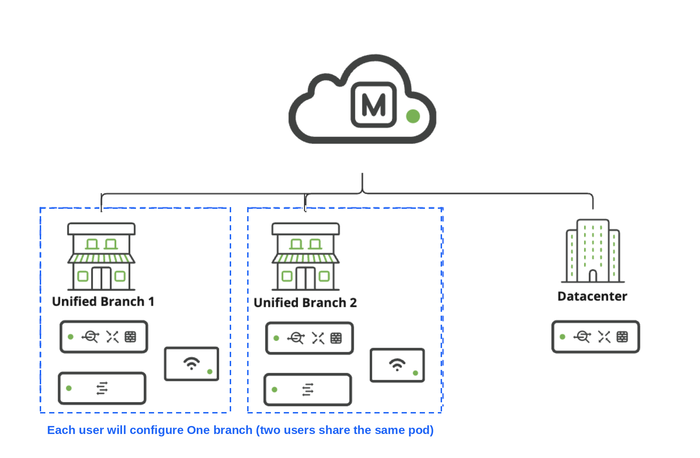
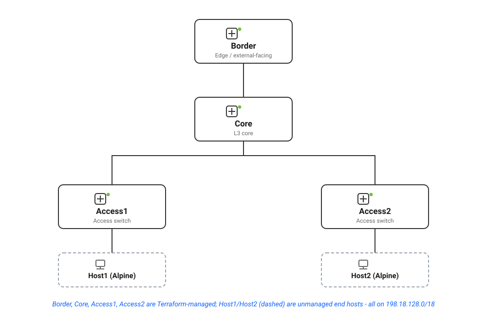

# Topologies

TODO. Make pictures same style and size. 
Add the Info about IP/HOSTNAMES/env variables used etc..

Visual reference for both halves of the lab - how the Meraki branch networks
are organized, and how the IOS-XE devices are wired.

## Part 1 - Meraki

<figure markdown="span">
  <figcaption>Each
  participant configures one Unified Branch (two participants share a pod);
  a shared Datacenter network is reachable from both.</figcaption>
</figure>

## Part 2 - IOS-XE

<figure markdown="span">
  <figcaption>Border and
  Core are the L3 core; Access1/Access2 are access switches, each hosting one
  unmanaged Alpine Linux end host. All 4 IOS-XE devices and both hosts share
  the 198.18.128.0/18 management subnet.</figcaption>
</figure>

---

**← Back to:** [Overview](Intro01_overview.md)
